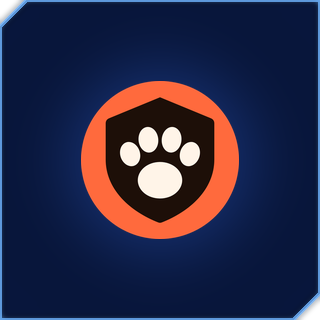
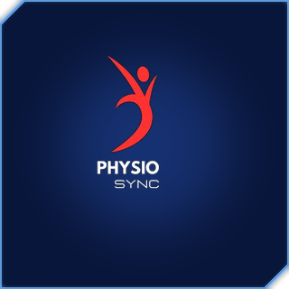
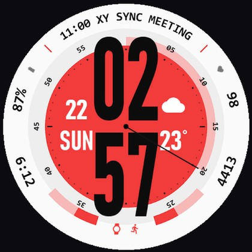
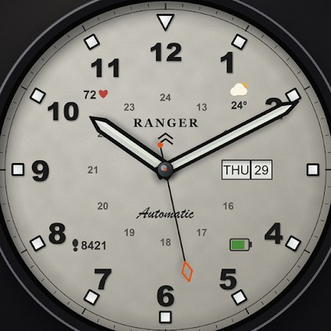
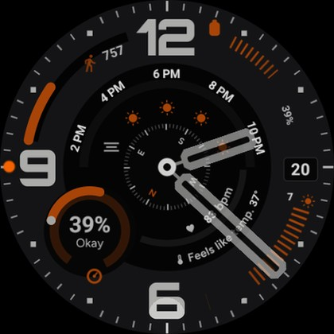

  
  
  
  

<table>
<tr>
<td width="33%" valign="top">
<b>&#9656; Who</b> 
Website and app developer, graphic designer and video editor from Karachi. I design the interface, then build it end to end, from database to deploy.
</td>
<td width="33%" valign="top">
<b>&#9656; Now</b> 
Frontend &amp; App Development Intern at <b>AKSIQ</b>, building React interfaces and React Native screens wired to REST APIs.
</td>
<td width="33%" valign="top">
<b>&#9656; Also</b> 
Freelance client sites and apps on Fiverr, my own live store ShopXtra, and Wear OS watch faces on Google Play.
</td>
</tr>
</table>

   
  

<table align="center">
<tr>
<td align="center" width="25%"> <b>PathSeeker</b></td>
<td align="center" width="25%"> <b>ShopXtra</b></td>
<td align="center" width="25%"> <b>FurShield</b></td>
<td align="center" width="25%"> <b>PhysioSync</b></td>
</tr>
<tr>
<td align="center" width="25%"> <b>Campus Coin</b></td>
<td align="center" width="25%"> <b>CARE Group</b></td>
<td align="center" width="25%"> <b>Zaika-e-Karachi</b></td>
<td align="center" width="25%"><a href="https://hamzaharoon.vercel.app/#work"><b>&#9656; Fly through all my work in 3D</b></a></td>
</tr>
</table>

Designed in Watch Face Format, tested on my own Galaxy Watch Ultra, published as paid apps.

<table>
<tr>
<td align="center" width="33%"> <b>Stack Time Pro</b></td>
<td align="center" width="33%"> <b>Ranger Field</b></td>
<td align="center" width="33%"> <b>Summit Analog</b></td>
</tr>
</table>

  Got a site, app or watch face in mind?  
  

