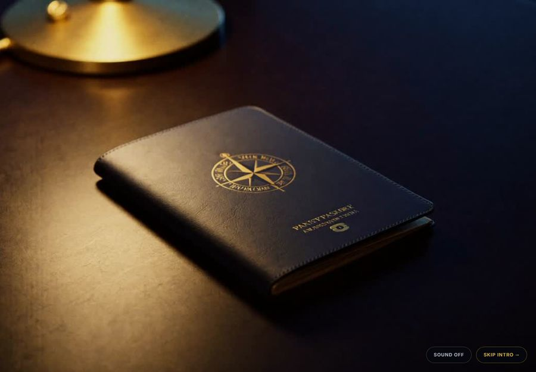
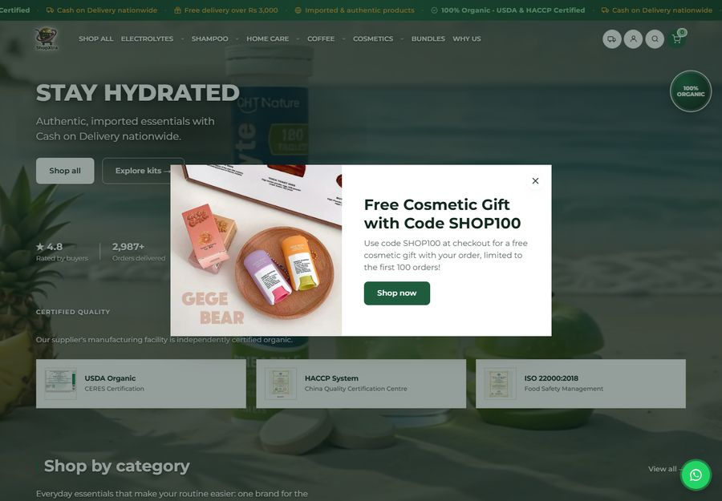
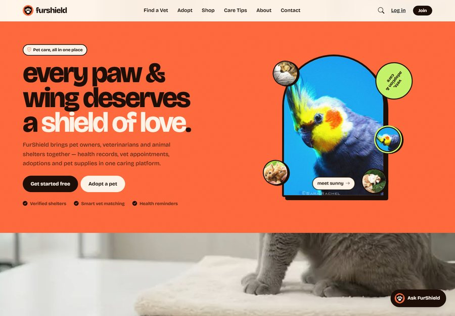
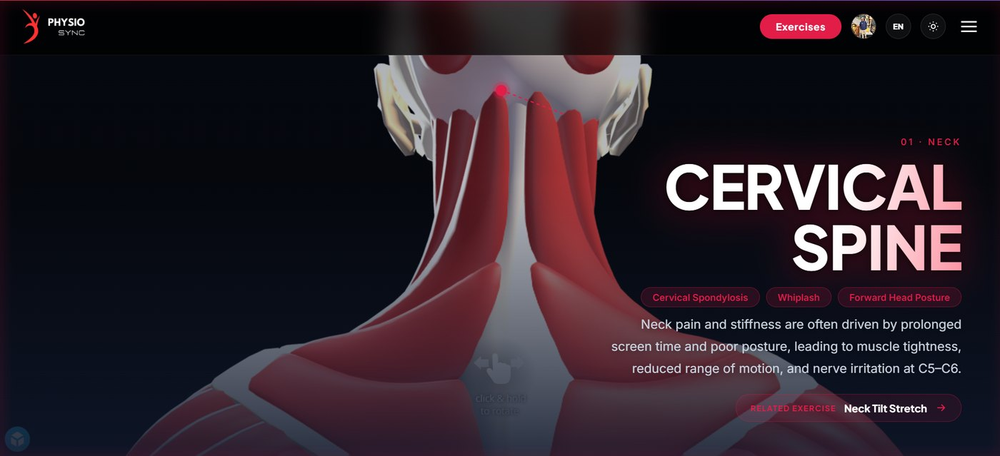
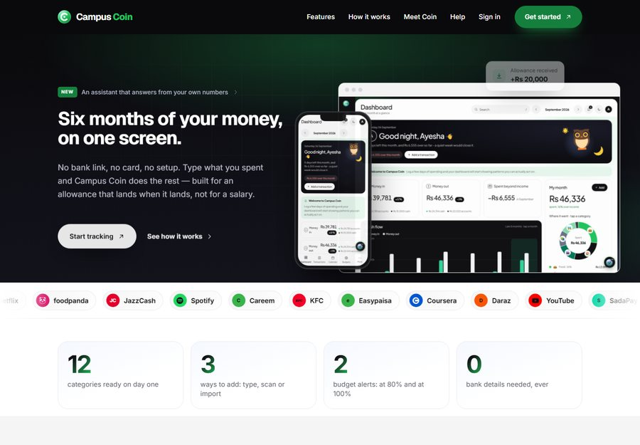
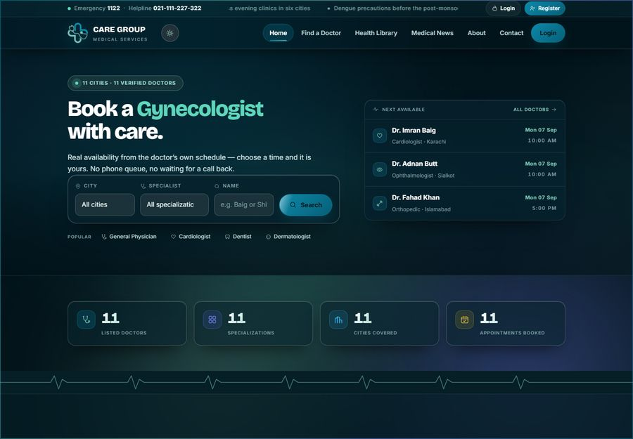
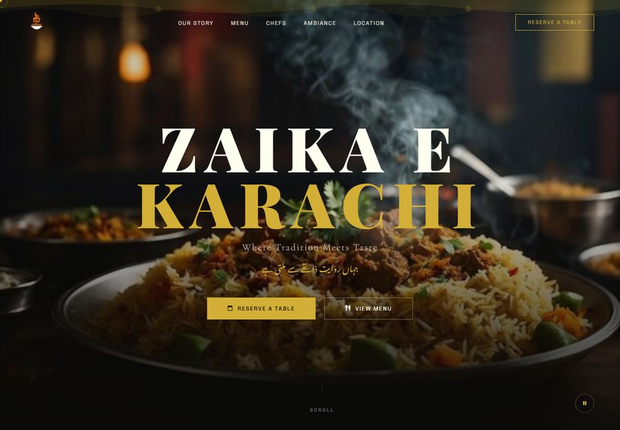

  
  
  
  

<table>
<tr>
<td width="33%" valign="top">
<b>&#9656; Who</b> 
Website and app developer from Karachi. I design the interface, then build it end to end, from database to deploy.
</td>
<td width="33%" valign="top">
<b>&#9656; Now</b> 
Frontend &amp; App Development Intern at <b>AKSIQ</b>, building React interfaces and React Native screens wired to REST APIs.
</td>
<td width="33%" valign="top">
<b>&#9656; Also</b> 
Freelance client sites and apps on Fiverr, my own live store ShopXtra, and Wear OS watch faces on Google Play.
</td>
</tr>
</table>

   
  

<table>
<tr>
<td width="50%" valign="top">

<b><a href="https://careerpassporttw.vercel.app/">PathSeeker</a></b> &nbsp;MERN 
Ten honest questions matched against 38 real careers, staged as a boarding pass journey.
</td>
<td width="50%" valign="top">

<b><a href="https://www.shopxtra.store/">ShopXtra</a></b> &nbsp;Live store 
A working organic grocery shop on its own domain, with promo codes and cash on delivery.
</td>
</tr>
<tr>
<td width="50%" valign="top">

<b><a href="https://furshiel.vercel.app/">FurShield</a></b> &nbsp;MERN · JWT 
One platform for pet owners, vets and shelters, with health timelines and adoption listings.
</td>
<td width="50%" valign="top">

<b><a href="https://physiosync-pk.vercel.app/">PhysioSync</a></b> &nbsp;3D · GSAP 
Pick a region on a 3D body model and it maps the pain to conditions and exercises.
</td>
</tr>
<tr>
<td width="50%" valign="top">

<b><a href="https://campuscoin-sable.vercel.app/">Campus Coin</a></b> &nbsp;MERN 
A budget tracker for students on allowance, with CSV import, charts and budget alerts.
</td>
<td width="50%" valign="top">

<b><a href="https://care-pk.infinityfreeapp.com/">CARE Group</a></b> &nbsp;PHP · MySQL 
A three role doctor appointment portal with live availability grids.
</td>
</tr>
<tr>
<td width="50%" valign="top">

<b><a href="https://zaikaekarachi.vercel.app/">Zaika-e-Karachi</a></b> &nbsp;GSAP · English &amp; Urdu 
A scroll told history of a Karachi kitchen, from partition era recipes to Burns Road bun kababs.
</td>
<td width="50%" align="center" valign="middle">
<a href="https://hamzaharoon.vercel.app/#work"><b>&#9656; Fly through all my work in 3D</b></a> 
hamzaharoon.vercel.app
</td>
</tr>
</table>

Designed in Watch Face Format, tested on my own Galaxy Watch Ultra, published as paid apps.

<table>
<tr>
<td align="center" width="33%"> <b>Stack Time Pro</b></td>
<td align="center" width="33%"> <b>Ranger Field</b></td>
<td align="center" width="33%"> <b>Summit Analog</b></td>
</tr>
</table>

  Got a site, app or watch face in mind?  
  

