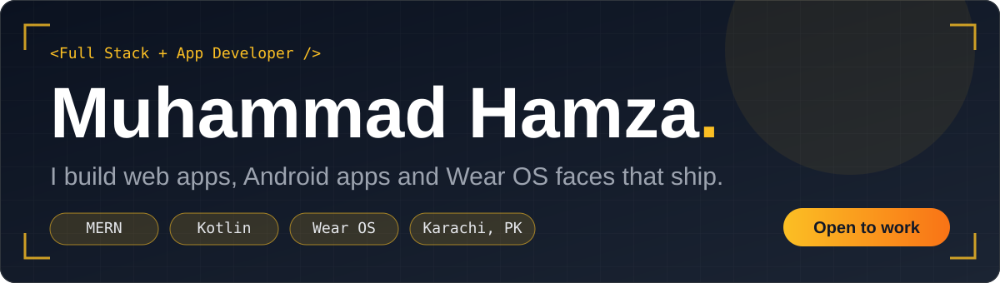

  
  
  
  

  

## 👨‍💻 About me

- 🏗 I build **complete products**: store fronts, portals, MERN platforms and native Android apps.
- ⌚ I publish **Wear OS watch faces** on Google Play.
- 🎬 I also edit and post short-form videos as a creator.
- 📍 Based in **Karachi, Pakistan**. Open to **freelance and remote** roles.

## 🛠 Tech stack

   
  

## 🚀 Featured work

<table>
<tr>
<td width="50%" valign="top">

**🛍 ShopXtra**
Live online store, redesigned end to end.
`React` `Vercel`

**🏥 CARE**
Doctor appointment portal with live booking.
`PHP` `MySQL`

</td>
<td width="50%" valign="top">

**💸 CampusCoin**
Student budget tracker, web and native Android.
`MERN` `Kotlin` `Compose`

**⌚ Wear OS watch faces**
Original faces, published on Google Play.
`Kotlin` `Watch Face Format`

</td>
</tr>
</table>

  
  

  
  

## 📊 GitHub stats

  
  

  

## 🤝 Let's build something

Need a website, a store or an Android app? Message me on [LinkedIn](https://www.linkedin.com/in/muhammad-hamza-kodwavi-91532b281/) or hire me on [Fiverr](https://www.fiverr.com/hamzaharoon1207).

